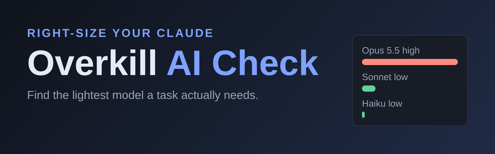
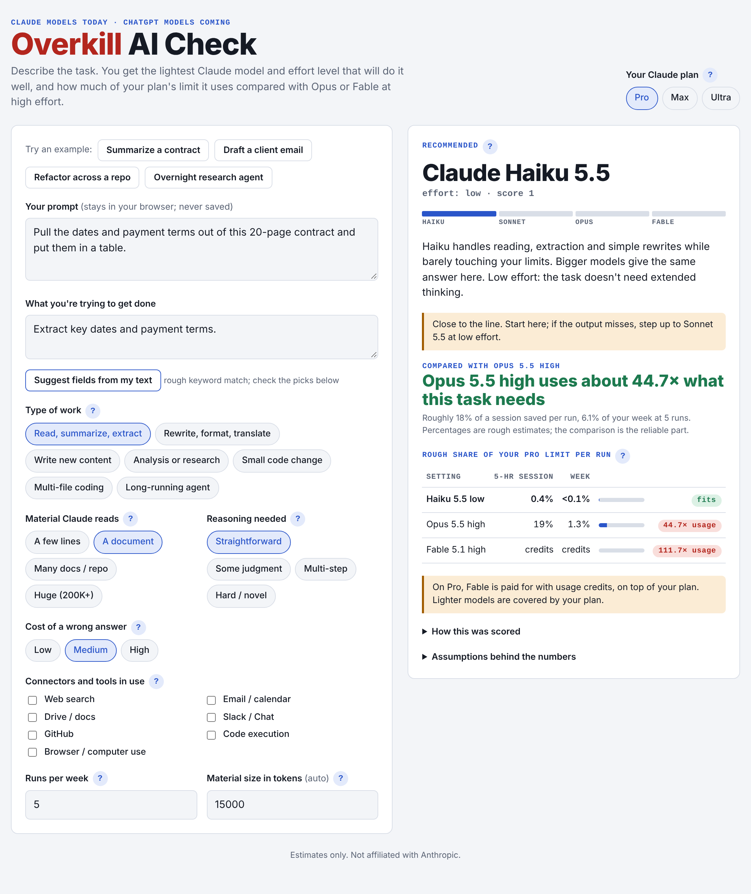
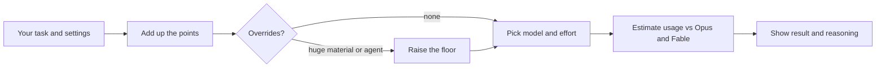

  

<h1 align="center">Overkill AI Check</h1>

<strong>Stop using Opus to proofread an email.</strong>

Describe a task. Get the lightest Claude model and effort level that should still do the job, and how much of your Pro, Max or Ultra limit it takes next to Opus or Fable on high.

  
  
  
  
  

  <a href="#why-i-built-it">Why</a> ·
  <a href="#what-you-get">What you get</a> ·
  <a href="#how-the-score-works">How it scores</a> ·
  <a href="#how-usage-is-estimated">Usage estimates</a> ·
  <a href="#run-it">Run it</a> ·
  <a href="#privacy">Privacy</a> ·
  <a href="#roadmap">Roadmap</a>

  

> **Status:** early release. The recommendations come from fixed rules, and the usage percentages are estimates, not measurements. The comparisons between models are the reliable part. See [How usage is estimated](#how-usage-is-estimated).

## Why I built it

I kept seeing people run Claude Opus on high effort, and sometimes Fable, to summarize a PDF or clean up an email. The answer comes out fine, but it is the same answer a lighter model would give, and it uses up plan limits much faster.

Claude subscriptions do not bill per message. They have a 5-hour session limit and a weekly limit, and heavier models, higher effort, long chats and connected tools all drain them faster. This tool shows that tradeoff before you press send.

It also says so when the big model is the right call. The goal is the right model, not the cheapest one.

## What you get

| You enter | You get |
|---|---|
| Your prompt and what you are trying to get done | A recommended model and effort level, with a one-line reason |
| How much Claude reads, how much reasoning it needs, what a wrong answer costs | A score and a plain breakdown of how it was reached |
| Which connectors and tools are on, and how often you run it | How many times more Opus 5.5 high and Fable 5.1 high would use |
| Your plan (Pro, Max or Ultra) | A rough share of your session and weekly limit per run |

A few examples of what comes out:

| Task | Recommendation |
|---|---|
| Pull dates and payment terms from a 20-page contract | Haiku, low effort |
| Draft a short client email | Sonnet, low effort |
| Refactor code across a repo | Opus, high effort |
| Overnight research agent with browser use | Fable, high effort |

Every field has a small **?** that explains it in plain language, so you do not need to know what a token or an effort level is to use it.

## How the score works

The recommendation comes from fixed rules, not an AI call. It costs nothing to run and gives the same answer every time. Each field adds points:

| Factor | Points |
|---|---|
| Type of work (read, rewrite, write, analyze, small code, multi-file code, agent) | 0–10 |
| Material Claude reads | 0–3 |
| Reasoning needed | 0–6 |
| Cost of a wrong answer | 0–2 |
| Connectors and tools (browser use adds 1) | 0–3 |

| Total | Recommendation |
|---|---|
| 0–2 | Haiku, low |
| 3–5 | Sonnet, low |
| 6–8 | Sonnet, medium |
| 9–11 | Opus, medium |
| 12–15 | Opus, high |
| 16+ | Fable, high |

Two overrides apply: very large material never gets Haiku, and long-running agents never go below Opus. When a score sits next to a cutoff, the page says so and suggests a test run. Open **How this was scored** on any result to see the breakdown.

Everything runs in the page. There is no server and no AI call in this loop.

## How usage is estimated

<strong>What the numbers assume</strong>

 

Anthropic does not publish exactly how large a session or a week is, or how each model counts against it. So the figures here are estimates:

- Models are weighted by their relative API prices, since heavier models use limits faster.
- A Pro 5-hour session is assumed to be about 45 short messages on a mid-size model, based on Anthropic's published guidance. A Pro week is assumed to be about 15 sessions.
- Max is 5× Pro. Ultra is 10× Pro per week, with no 5-hour limit once verified.
- Thinking grows with effort, and coding and agent work count several turns.
- On Pro, Fable is paid with usage credits. On Max and Ultra it can use up to half of the weekly limit.

Comparisons like "Opus uses about 3× more here" are more trustworthy than the exact percentages. Prices, plan sizes and the session assumption sit near the top of the script in `index.html` (`P`, `PLANS`, `PRO_SESSION`, `PRO_WEEK`), so they are easy to update when they change.

## Run it

It is one static page with no build step and nothing to install. Open `index.html` in a browser.

<strong>Deploy to Cloudflare Pages</strong>

 

1. In Cloudflare, create a Pages project and connect this repository.
2. Framework preset: **None**. Build command: leave empty. Build output directory: `/`.
3. Deploy.

Any static host works the same way.

## Privacy

<strong>What stays on your device</strong>

 

- No accounts, analytics or tracking.
- No API key, and no calls to any AI service.
- Your prompt never leaves your browser and is never saved.
- Your plan choice is remembered in your browser's local storage.
- The only outside request is loading fonts from Google Fonts.

## Roadmap

- [ ] ChatGPT models
- [ ] A Claude Code plugin that routes each request to the right model automatically
- [ ] Measured usage numbers from real before-and-after readings, replacing the estimates
- [ ] Optional AI-assisted field filling that uses your own key and runs only when you ask

## Contributing

Corrections to prices, plan sizes or the scoring rules are the most useful changes. See [CONTRIBUTING.md](CONTRIBUTING.md) and the [changelog](CHANGELOG.md).

---

Overkill AI Check is licensed under [AGPL-3.0](LICENSE). Copyright © 2026 Angelo De Leon.

It is an independent project and is not affiliated with or endorsed by Anthropic. Claude is a trademark of Anthropic.
